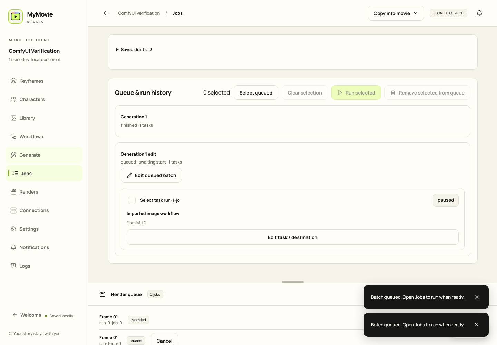
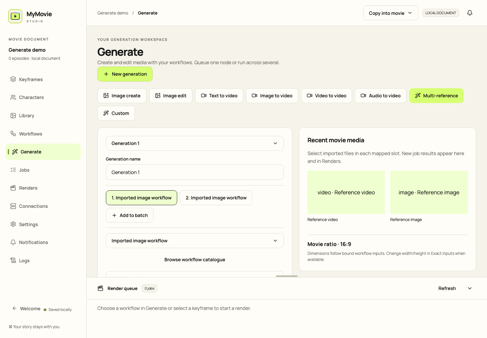
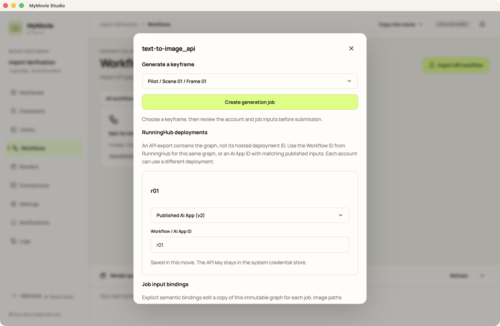

# MyMovie Studio

[Télécharger les releases](https://github.com/gubnota/auteur/releases/tag/v0.1.6) — macOS Apple Silicon/Intel, Windows x64, Linux x86_64/ARM64 et agents ComfyUI. Les installateurs Windows ne sont pas signés ; la notarisation macOS reste à réaliser.

La branche main et l’application macOS installée sont en **0.1.9** ; le téléchargement public reste **v0.1.6** jusqu’au prochain tag. **Generate** est l’unique éditeur ; **Jobs** contient file et historique. **Edit queued batch** ouvre Generate : modifiez **Execution node**, puis **Save queue changes**. La vérification distingue **Add to queue** et **Run now**. Supprimez les éléments du lot, réutilisez les tâches démarrées comme brouillons et effacez les lignes terminées avec **Clear finished**, en conservant reçus et résultats.

Redux FaceSwap est configuré comme RunningHub Workflow **2110376761482002434** : **19.image = Face identity reference**, **86.image = Base photograph**. Le chargeur déconnecté 88 reste inactif. Les nouveaux jobs réutilisent ces champs ; choisissez les médias dans la galerie ou déposez des fichiers. La correspondance hébergée est confirmée par l’utilisateur ; aucune exécution payante n’a été testée.

**0.1.9** corrige le contrôle matériel avant transfert qui rejetait à tort les workflows CUDA sur RunningHub. Dans **Jobs**, choisissez **Reuse** pour la tentative échouée, vérifiez les images et le compte conservés, puis lancez le nouveau brouillon. L’ancien reçu d’échec reste dans l’historique.

Configurez une fois les champs exacts dans **Workflows → Reusable inputs** : libellés, rôles image/vidéo/audio, texte, nombres, boolean, JSON, Advanced et Hidden. Les champs utilisés sont signalés et les doublons bloqués. Generate réutilise ce formulaire et une galerie de vignettes avec recherche. **Library** et **Renders** partagent les mêmes médias, tags Render, utilisation et provenance ; **Trash / Restore** fonctionne aussi par sélection multiple. Un import identique conserve son ID et son lien externe jusqu’à Collect. Vignettes vidéo, noms tronqués, Welcome et suppression des récents restent disponibles. Voir [configuration](docs/WORKFLOW_SETUP.md) et [validation](docs/GENERATION_ACCEPTANCE.md).



La version publiée **0.1.6** a ajouté un catalogue commun de workflows, la préparation du JSON éditeur via le ComfyUI sélectionné, des formulaires issus des types réels et les agents macOS/Linux. Importez une fois puis réutilisez les versions et destinations dans Generate et Jobs.

Compilation release : `npm run tauri:build -- --bundles app` ; résultat : `target/release/bundle/macos/MyMovie Studio.app`. L’installation locale utilise une signature ad hoc ; la notarisation Apple reste à réaliser.

Un studio de cinéma local pour macOS, construit avec Rust, Tauri et React. Les films sont des paquets Finder `.mymovie` contenant épisodes, storyboard ordonné, personnages, workflows importés, tâches de génération et médias. L’interface reprend la palette Fenki avec un symbole SVG original.

[English](README.md) · [Русский](README.ru.md) · [État du projet](docs/PROJECT_CONTEXT.md)


## Main actuelle : Generate et configuration portable

**Generate** utilise un espace Custom pour les workflows image/vidéo/audio, autonomes ou liés au storyboard. Choisissez workflow et nœud enregistrés, médias et valeurs, puis vérifiez le lot. **Add to queue** enregistre sans lancer ; **Jobs → Run queued batch / Run all queued** démarre le travail. Une instance ComfyUI utilise une file ; les instances distinctes travaillent en parallèle.

**Workflows → Compatibility & initialization** propose les indicateurs Unspecified, Universal, Apple Silicon, CUDA, ROCm et CPU ainsi que les sources, empreintes, licences et destinations des modèles, plugins et wheels Python. Les [commandes portables](docs/WORKFLOW_SETUP.md) expliquent Python de l’instance, dossiers réels, installation, stockage privé, redémarrage et test de session. Le [guide RunPod/Colab](deploy/runpod/README.md) explique comment obtenir l’adresse HTTPS du relais.

Schéma **v4** : la mise à niveau depuis v1/v2/v3 exige confirmation et sauvegarde. Les anciennes applications ne peuvent pas ouvrir le paquet mis à niveau.

L’application macOS 0.1.6 a précédemment exécuté Generate → Jobs → Renders avec un workflow éditeur enregistré et le nœud local : PNG de 64 × 114 au format 9:16. Le format a été conservé après réouverture du film. Voir les [résultats de validation](docs/GENERATION_ACCEPTANCE.md).




## Utiliser un film

Créez un film et choisissez son emplacement, ou ouvrez un `.mymovie` existant. Modifiez les noms du film et des épisodes, ajoutez scènes et plans, puis organisez les images clés. Vous pouvez modifier prompts, commentaires, proportions et personnages. Chaque image hérite des personnages de sa scène.

Importez les références des personnages depuis leur éditeur. Le traitement des dépôts de fichiers est implémenté pour les personnages, la bibliothèque, les images clés, les plans et les nouvelles scènes. La validation d’un véritable glisser-déposer depuis Finder reste ouverte ; utilisez les boutons d’importation si le dépôt ne fonctionne pas.

## Copier ou conserver les fichiers d’origine

Le contrôle **Media imports** propose deux modes :

- **Copy into movie** : mode par défaut ; copie des originaux dans le paquet, avec déduplication par contenu.
- **Keep original location** : référence au fichier existant sans copie. L’original doit rester accessible.

Cela concerne images, vidéos, audio et fichiers LoRA pris en charge, y compris les références des personnages. Les définitions de workflows sont importées séparément dans le film.

La bibliothèque affiche les chemins externes. **Check files** détecte les originaux manquants ou modifiés. **Relink** retrouve un original déplacé uniquement si son contenu correspond exactement ; les associations restent intactes.

Avant de transférer le film, utilisez **Collect for export**. Cette commande vérifie et copie tous les médias liés dans le `.mymovie` actuel, en conservant leurs associations. Un original manquant ou modifié interrompt le regroupement. Fermez le film, puis copiez le paquet complet dans Finder. Un assistant distinct de création d’archive ou de copie d’export n’est pas encore disponible.

L’importation par dialogue natif et le regroupement d’une référence de personnage liée ont été vérifiés dans l’application macOS.

## Workflows et connexions

Importez un workflow éditeur ou API une seule fois via **Browse workflow catalogue**. Préparez le workflow éditeur sur le ComfyUI choisi avec les [prérequis du compilateur](docs/WORKFLOW_SETUP.md). Dans **Workflows → Reusable inputs**, enregistrez champs littéraux, libellés, rôles et visibilité une fois. Les champs API sans registre restent non vérifiés. Les profils ComfyUI anciens ou modifiés sont actualisés avant une nouvelle vérification/figeage ; un échec conserve le brouillon. Les sérialiseurs non pris en charge et changements de branche dynamique demandent correction/export. Graphes originaux et anciennes tentatives restent immuables.

**Customize input form** enregistre les libellés, groupes, ordre et résultats sélectionnés. Le ratio modifie uniquement les dimensions width/height liées ; choisissez la paire si plusieurs existent. Changer de branche dynamique exige une nouvelle préparation. **Export API** utilise le profil préparé de la destination. Installation Python, Playwright et Chromium : [WORKFLOW_SETUP](docs/WORKFLOW_SETUP.md). RunningHub réutilise un déploiement autorisé enregistré ; les graphes arbitraires ne sont pas publiés automatiquement.

Pour un workflow API, configurez les champs exacts dans **Workflows → Reusable inputs**, puis réutilisez le formulaire. Les entrées `characterReference1` à `characterReference4` utilisent les personnages assignés ; les identifiants des nœuds ne sont pas devinés.

Plusieurs connexions ComfyUI, RunningHub et relay privé sont possibles. L’aide aux prompts via Google, DeepSeek et OpenRouter est facultative. Saisissez les secrets dans les contrôles sécurisés de l’application ; ils restent dans le Trousseau macOS. Les endpoints fal/personnalisés disposent actuellement d’une interface de configuration uniquement.

Les reçus des tâches et leurs résultats persistent. Une soumission ambiguë devient unknown sans relance aveugle. Le relay propose SSE avec reprise des événements ; l’application utilise actuellement le polling. Progression dans le Dock, notifications système et historiques de notifications/journaux sont disponibles.

## Jobs : entrées exactes et lots

Créez ou ouvrez un lot dans **Generate** ; les commandes workflow/image clé ouvrent le même éditeur. Ajoutez, supprimez, dupliquez et ordonnez les éléments indépendants. Chacun utilise un nœud enregistré et le formulaire du workflow. Les valeurs exactes conservent chaîne vide, zéro, false et JSON. La galerie affiche recherche, vignettes et médias utilisés, en réutilisant les IDs sans copie. **Jobs** contient file/historique et ouvre Edit/Reuse dans Generate.

**Review exact inputs** valide le lot avant tout téléversement. L’aperçu montre les empreintes des médias ; graphe et payload finaux sont conservés dans le reçu. **Add to queue** fige sans lancer ; **Run now** démarre. Save queue changes remplace atomiquement les tentatives non démarrées, en conservant les originaux annulés. Aucune dépendance chaînée entre workflows n’est disponible.

Les éléments partageant un endpoint ComfyUI normalisé suivent une FIFO, même via des connexions dupliquées. Les endpoints distincts fonctionnent en parallèle. Pour le relay, la file dépend de son URL et du node ID ; utilisez une connexion par worker GPU RunPod. RunningHub respecte la capacité de chaque compte. Les alias d’URL distincts d’un même serveur ne sont pas identifiés automatiquement.

Pause arrête les éléments en attente ; Cancel demande aussi l’annulation du travail actif. Les éléments non envoyés restent en pause après réouverture jusqu’à **Resume waiting**. Une soumission incertaine bloque sa file jusqu’à réconciliation ; les autres instances continuent. Runs et la provenance Renders conservent les ID de lot/élément et les snapshots exacts.

La migration sauvegarde SQLite et le manifest dans `backups/` du paquet. Conservez une copie complète du projet original pour continuer avec une ancienne version.


## ComfyUI privé sur RunPod

Le [guide de l’agent RunPod](deploy/runpod/README.md) explique le déploiement de l’artefact CI Linux x86_64/ARM64 près de ComfyUI privé. L’agent contacte un relay HTTPS authentifié en sortie ; aucun port public ComfyUI n’est nécessaire. CI fournit le binaire ELF, les instructions, les métadonnées et les empreintes SHA-256. Les poids et custom nodes doivent être installés au préalable. La synchronisation automatique LoRA/runtime via S3 et une validation complète RunPod/GPU restent à réaliser.

## RunningHub : créer une tâche

1. Ajoutez un compte RunningHub dans **Connections** et enregistrez sa clé avec le contrôle sécurisé des identifiants.
2. Importez le workflow API dans **Workflows**. Dans **RunningHub deployments**, sélectionnez le compte, la famille API (**Workflow** ou **AI App**) et l’ID de ce déploiement précis. Un graphe JSON ne prouve pas l’existence d’un déploiement hébergé ; ne remplacez pas son ID par celui d’une autre AI App. L’ID par défaut du compte est facultatif.
3. Configurez **Reusable inputs** avec les nœuds, champs et types du schéma API de ce déploiement. Les références de personnages proviennent de la scène/image sélectionnée.
4. Sélectionnez **Target keyframe**, cliquez sur **Create generation job**, choisissez le compte, vérifiez les valeurs puis **Review exact inputs** → **Add to queue / Run now**. Le dialogue explique les paramètres manquants.

Un refus du fournisseur produit une tâche failed. Pour une soumission incertaine, consultez l’historique RunningHub puis **Resolve submission** : rattachez l’ID de la tâche existante ou confirmez qu’aucune tâche n’a été créée avant de relancer. Le compte et le déploiement restent figés dans le reçu.

L’interface et les contrats ont été vérifiés avec des fixtures ; aucune génération RunningHub payante n’a été validée. La [page Workflow fournie](https://www.runninghub.ai/workflow/2110044532631932930) indique la famille **Workflow** et l’ID `2110044532631932930`. L’utilisateur a confirmé que cet ID correspond au LTX API JSON fourni ; les détails publics du graphe n’ont pas été vérifiés indépendamment. Les entrées de type chaîne sont `positivePrompt → 121.text`, `negativePrompt → 110.text` et `image → 167.image`. Assignez une image à l’image clé cible avant l’envoi ; la commande native refuse une tâche sans image.



## Artefacts CI et notebooks

Le [guide des builds et releases](docs/CI_RELEASES.md) décrit `.gitlab-ci.yml`, GitHub Actions, les DMG macOS ARM/Intel, les installateurs Windows x64 MSI/EXE, les paquets Linux et le client ComfyUI Linux x86_64/ARM64. Les tags doivent correspondre à la version de l’application ; les fichiers sont accompagnés de sommes de contrôle. Les tags réussis publient une préversion GitHub complète après validation de toutes les builds natives. Le remote actuel est GitHub ; GitLab nécessite un projet et un runner macOS adapté.

Les notebooks [Colab](deploy/colab) et [Kaggle](deploy/kaggle) déploient l’artefact vérifié du client près d’une installation ComfyUI existante. Kaggle peut utiliser deux processus GPU indépendants, avec ports et node ID distincts. Le déploiement réel nécessite un relay authentifié et un runtime actif autorisant ce fonctionnement.

## Développement

Prérequis : Apple Silicon, macOS 13+, Xcode Command Line Tools, Rust et Node.js/npm.

```sh
npm ci
npm run tauri:dev
npm run tauri:build -- --debug --bundles app
```

Application de développement non signée : `target/debug/bundle/macos/MyMovie Studio.app`. L’aperçu navigateur (`npm run dev`) utilise un état temporaire en mémoire ; testez les fichiers et paquets dans l’application native.

```sh
npm run typecheck
npm test -- --maxWorkers=1
cargo test --workspace
```

## Vérification locale sur CPU

```sh
docker compose -f deploy/cpu/compose.yaml up -d --build
python3 scripts/cpu-smoke.py
```

Le moteur OrbStack/Docker doit rester actif ; la fenêtre OrbStack peut être fermée. Le test CPU sans poids de modèles a validé disponibilité ComfyUI, soumission, historique et téléchargement du résultat. Il ne valide pas les workflows vidéo sur GPU.

## Limites actuelles

La génération RunningHub réelle, relay/S3/RunPod distant, notebooks cloud, notarisation et gestes Finder restent à valider. L’export éditeur→API local et FaceSwap avec poids ont été vérifiés ; les résultats portent les empreintes et la provenance du job. Les plugins personnalisés exigent un frontend compatible et une vérification des dépendances. Profils de navigateur, entraînement LoRA et pipeline FFmpeg complet restent des étapes ultérieures.
