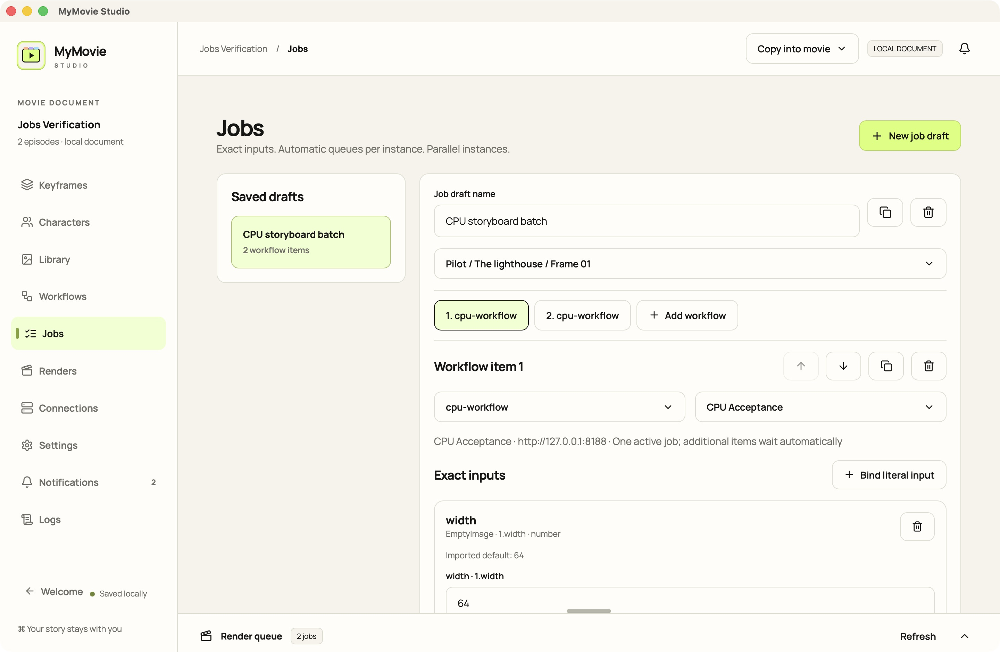

# MyMovie Studio

[Download releases](https://github.com/gubnota/auteur/releases/tag/v0.1.6) — macOS Apple Silicon/Intel, Windows x64, Linux x86_64/ARM64 and headless ComfyUI agents. Windows installers are unsigned; macOS notarization remains pending.

Current main and the local macOS installation are **0.1.7**; the public download above remains **v0.1.6** until a new release tag. Use **Add to queue** to save an idle batch, then **Run queued batch** or **Run all queued**. Collapse the Jobs editor, select **Edit queued batch**, change **Execution node**, and **Save queue changes**. Started jobs offer **Reuse as draft**. Generate items can be removed, including the last one. **Clear finished** empties terminal entries from the bottom panel while preserving history and results.

Input forms show essential media/prompts first; Advanced and hidden fields are expandable. Explicit two-image roles can be swapped. Normal editor workflows can be installed into the selected ComfyUI library through the utility, then prepared/exported without repeated API uploads. Library adds video posters, filename ellipsis and usage links; Characters link to assigned frames. Welcome is always reachable, with scrollable/removable recent movies. Linux ARM64 install/compile was tested in OrbStack Debian. See [setup](docs/WORKFLOW_SETUP.md) and [actual acceptance](docs/GENERATION_ACCEPTANCE.md).


Version **0.1.6** introduced a reusable workflow catalogue, automatic editor-to-API compilation against the selected ComfyUI frontend, generated input forms, real dimension controls and macOS/Linux agent utilities. Jobs preserve exact inputs, queue on one instance and run in parallel across different instances. RunPod ComfyUI is the main execution target; RunningHub tests saved hosted deployments. Older documents upgrade to schema v4 only after an explicit backed-up migration; older apps cannot open the upgraded package.

Release build: `npm run tauri:build -- --bundles app`; output: `target/release/bundle/macos/MyMovie Studio.app`. Local installation uses an ad-hoc signature; Apple notarization remains pending.

A local-first macOS film studio built with Rust, Tauri and React. Movies are Finder `.mymovie` document packages containing episodes, an ordered storyboard, characters, imported workflows, generation records and media. The desktop uses Fenki’s palette and an original SVG symbol.

[Русский](README.ru.md) · [Français](README.fr.md) · [Implementation status](docs/PROJECT_CONTEXT.md)


## Current main: Generate and portable workflow setup

**Generate** supports image/video creation and editing, start frames, multiple references, reference video and audio through explicit workflow bindings. Choose a node for each item, add it to a saved batch, then review and run all in **Jobs**. One ComfyUI instance queues work; different instances dispatch concurrently.

**Workflows → Compatibility & initialization** provides Unspecified, Universal, Apple Silicon, CUDA, ROCm and CPU flags, plus reviewed model/plugin/wheel sources, hashes, licenses and destinations. [Portable setup commands](docs/WORKFLOW_SETUP.md) explain instance Python, effective model folders, plugin installation, private storage, restart and first-session canary. [RunPod/Colab connection instructions](deploy/runpod/README.md) explain the HTTPS relay address.

Documents use schema **v4**, with backed-up upgrades from v1/v2/v3. Local frontend compilation, safe MPS FaceSwap and the weight-free canary were tested; [acceptance evidence](docs/GENERATION_ACCEPTANCE.md) separates real execution, fixture UI checks and pending cloud tests.

The installed macOS app completed Generate → Jobs → Renders using a saved editor workflow and local node, producing a 64 × 114 PNG at 9:16. The saved ratio also survived reopening the movie.


## Working with a movie

Create a movie and choose its location, or open an existing `.mymovie` package. Rename the movie and episodes, add scenes and shots, then arrange keyframes. Edit prompts, comments, aspect ratios and participating characters. Scene characters are inherited by their frames.

Import character reference images through the character editor. File-drop routing is implemented for characters, the Library, existing frames, shot lanes and new scenes. Actual Finder drag-and-drop acceptance is still unverified; use the import buttons if a drop does not arrive.

## Copy or link materials

The **Media imports** control offers two modes:

- **Copy into movie** (default): originals are copied into the package and deduplicated by content.
- **Keep original location**: the movie references the existing file without copying it. Keep the original available at that location.

This applies to imported images, videos, audio and supported LoRA files, including character references. Workflow definitions are imported separately into the movie.

The Library lists linked locations. **Check files** detects missing or changed originals. **Relink** accepts a replacement with the exact original content, preserving frame and character assignments.

Before transferring a linked movie, choose **Collect for export**. It verifies and copies all linked materials into the current `.mymovie`, keeping their assignments. Missing or changed originals stop collection. Close the movie, then copy the complete package in Finder. This is collection into the current movie; a separate archive/export-copy wizard is not implemented.

Native picker import and linked character reference collection were verified in the macOS app.

## Workflows and connections

Import a normal editor or API workflow once through **Browse workflow catalogue**. Select the saved workflow and execution node in Generate/Jobs, then **Prepare / refresh inputs**. Preparation derives controls from that instance’s real registry and exports through its installed frontend. Install the compiler prerequisites once using [setup instructions](docs/WORKFLOW_SETUP.md). Media slots, text, choices and numeric constraints appear automatically; customize labels, groups, Advanced visibility and collected outputs. Reuse this form and target for later jobs. Unsupported custom serializers/types remain explicit requirements. For API-specific semantic overrides, bind its prompt, image and other inputs. `characterReference1` through `characterReference4` can use reference images from the scene/frame cast. The app does not guess arbitrary node mappings.

Connections support multiple ComfyUI, RunningHub and private-relay records. Google, DeepSeek and OpenRouter prompt assistance is optional. Enter secrets through secure app controls; credentials are stored in the macOS Keychain. fal/custom generation endpoints currently have configuration UI only.

Job receipts and results persist. Ambiguous submissions become unknown rather than being retried blindly. The relay exposes replayable SSE; the desktop currently polls. Native Dock progress and system notifications accompany in-app notification/log histories.

## Jobs: exact inputs and batches

Open **Jobs** directly, or choose **Create generation job** from a workflow/keyframe. Save a named draft, select its target keyframe, then add, duplicate or reorder independent workflow items. Each item selects a connection and explicit bindings. Inputs support text, numbers, custom boolean toggles and parsed JSON. Prompts can use the composed project/scene/frame text or an exact override, including an empty string. Media selectors use movie assets and references from the assigned cast.

**Review exact inputs** validates the entire batch before uploads or creating attempts. Preview media shows asset hashes and a pending provider filename; the final staged graph/payload is stored in the attempt receipt. **Validate & start** freezes the configured batch. Original imported graphs remain unchanged. There is no chained output dependency in this version.

Items sharing a normalized ComfyUI endpoint queue in FIFO order, including duplicate connection records. Different endpoints run concurrently. Private relay connections use the relay URL and worker node ID as their lane; use one connection per RunPod GPU worker. RunningHub uses each account’s configured concurrency. Different URL aliases for the same server cannot be automatically identified.

Pause affects waiting items; cancel also requests cancellation of active work. Reopened unsent items are paused until **Resume waiting**. Unknown submissions block their lane until reconciled; other instances continue. The Runs history and Renders provenance retain run/item IDs and exact snapshots.

The schema v4 upgrade creates SQLite/manifest backups under the package’s `backups/` directory. Keep a complete copy of the original package if you need to continue using an older app.



## Private RunPod ComfyUI

Use the [RunPod agent guide](deploy/runpod/README.md) to deploy the CI-built Linux x86_64/ARM64 agent beside private ComfyUI. It connects outbound to an authenticated HTTPS relay; no public ComfyUI port is required. CI packages the real ELF agent, setup guide, metadata and SHA-256 checksums. The archive includes runtime and workflow compiler helpers. Managed initialization supports reviewed hash-pinned models/plugins/wheels and private transfer manifests; live installation and the private RunPod/S3/GPU roundtrip remain pending.

## RunningHub: create a job

1. Add a RunningHub account in **Connections** and save its key with the secure credential control.
2. Import the API workflow once in **Workflows**, then reuse it from the catalogue. In **RunningHub deployments**, select the account, API family (**Workflow** or **AI App**) and the hosted ID for that exact deployment. An imported JSON graph does not contain proof of a hosted deployment; do not substitute an unrelated AI App ID. An account default is optional.
3. Configure **Job input bindings** with node IDs, field names and value types from that deployment’s API schema. Character reference slots use the assigned scene/frame cast.
4. Choose **Target keyframe**, click **Create generation job**, then select the account, review the values and **Review exact inputs** → **Validate & start**. Missing setup is explained in the dialog.

Provider rejections are shown as failed jobs. For an uncertain submission, check RunningHub task history and use **Resolve submission** to attach the existing task ID or confirm that no task was created before retrying. Account/deployment destinations stay frozen in the job receipt.

The UI and provider contracts were tested with fixtures; a paid RunningHub generation has not been verified. The supplied [Workflow page](https://www.runninghub.ai/workflow/2110044532631932930) identifies **Workflow** API ID `2110044532631932930`. The user confirmed that this ID matches the supplied LTX API JSON; public graph details were not independently verified. Its string bindings are `positivePrompt → 121.text`, `negativePrompt → 110.text` and `image → 167.image`. Assign an image to the target keyframe before submission; a missing image is rejected by the native command.


## CI artifacts and notebooks

[Build and release guide](docs/CI_RELEASES.md) covers `.gitlab-ci.yml`, GitHub Actions, macOS ARM/Intel DMGs, Windows x64 MSI/EXE installers, Linux desktop packages, and the Linux x86_64/ARM64 ComfyUI client. Version tags must match the application version and publish checksums. Successful tags publish complete GitHub prereleases after all native builds pass. The current remote is GitHub; GitLab needs a project and eligible macOS runner.

Generated [Colab](deploy/colab) and [Kaggle](deploy/kaggle) notebooks deploy the verified client artifact beside an existing ComfyUI installation. Kaggle supports two independent GPU workers with separate ports/node IDs. Live notebook deployment requires an authenticated relay and a permitted active runtime.

## Development

Requirements: Apple Silicon macOS 13 or newer, Xcode Command Line Tools, Rust and Node.js/npm.

```sh
npm ci
npm run tauri:dev
```

Build an unsigned development application:

```sh
npm run tauri:build -- --debug --bundles app
```

Output: `target/debug/bundle/macos/MyMovie Studio.app`. Browser preview (`npm run dev`) uses temporary in-memory state; use the native app for file/package acceptance.

```sh
npm run typecheck
npm test -- --maxWorkers=1
cargo test --workspace
```

## Local CPU execution

```sh
docker compose -f deploy/cpu/compose.yaml up -d --build
python3 scripts/cpu-smoke.py
```

Keep the OrbStack/Docker engine running; the OrbStack window may be closed. The weight-free CPU canary verified ComfyUI health, submission, history and result download. It does not validate the supplied GPU video workflows.

## Current limits

This is a development foundation. Live RunningHub generation, private relay/S3/RunPod roundtrip, live notebook deployment, signing/notarization and complete Finder-drop acceptance remain pending. The published 0.1.6 release passed all five native desktop and four Mac/Linux agent builds; all 34 public downloads passed independent checksum, format and architecture verification. [Publication evidence](docs/CI_RELEASES.md) records the exact source and successful hosted run. Desktop runtime checks on Windows and Linux remain pending. Browser profiles, remote LoRA training and the complete FFmpeg derivative pipeline are later milestones. No paid generation or cloud rental was performed during validation.

See [architecture](docs/ARCHITECTURE_INDEX.md), [contracts](docs/API_CONTRACTS.md) and [test evidence](docs/TASK_LOG.md). Agents should read the six compact context documents before targeted source inspection. Keep `drafts/`, secrets and personal movie packages out of Git.

## License

Apache-2.0 OR MIT; see [Apache license](LICENSE-APACHE) and [MIT license](LICENSE-MIT).

Bundled font licenses: [Manrope](docs/licenses/Manrope-OFL.txt), [IBM Plex Mono](docs/licenses/IBM-Plex-Mono-OFL.txt).
