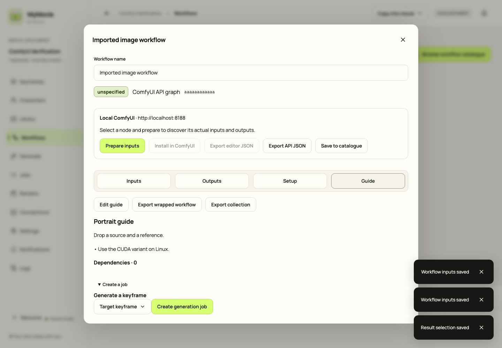

# MyMovie Studio

Version 0.1.19 adds a dark terminal that fills the window, **Enter full screen**, and automatic **Fit window** sizing. Shot lanes can be dragged, moved up/down or removed with confirmation. Renaming frames/characters preserves exact imported workflow graphs. Restore example copies immediately; select an instance in Setup for direct ComfyUI preparation/import (dependencies must already exist). Connections/Setup can save version-labelled CPU/GPU notebooks: upload a fresh copy and Run all. Agent connections install missing dependencies. Live cloud validation remains pending.

**Colab quick start:** open the [current notebook](https://colab.research.google.com/github/gubnota/auteur/blob/main/deploy/colab/MyMovie_ComfyUI.ipynb), connect a CPU or GPU runtime, and **Run all** unchanged. Predefined test keys, verified agent/relay, pinned ComfyUI, browser importer and cloudflared are set up automatically. Copy the printed relay URL/node ID into Connections with temporary-tunnel polling enabled. Models and workflow plugins are installed later from Studio. Run all leaves the node running; Stop is manual. Existing Drive copies must be reopened from this link to get updates.

**CPU mode:** both Colab and Kaggle default to `DEVICE = "auto"`: use available CUDA GPUs or start one CPU worker. Choose `"cpu"` to force CPU or `"cuda"` to require the configured GPU count. Test connections/setup with the weight-free mask canary; model generation on CPU can be very slow. Reopen the updated notebook; saved notebook copies do not update themselves.

[Test the connection from your desktop](docs/WORKFLOW_SETUP.md#test-the-notebook-connection-from-your-desktop): copyable Python script, matching desktop token and HTTP troubleshooting. The relay has no homepage; `/` and `/v1` return 404.

A portable film studio for macOS: Finder `.mymovie` packages, scenes and keyframes, shared characters and media, reusable ComfyUI workflows and traceable jobs.

Current source/app version: **0.1.18**. [Published v0.1.15 downloads](https://github.com/gubnota/auteur/releases/tag/v0.1.15) include the Linux agent and matching relay. Commit version changes before creating a matching tag; staging alone does not update a tag. Local macOS builds use an ad-hoc signature; notarization and foreign-platform launch acceptance remain pending.

## One workflow, many jobs

1. **Workflows:** import ordinary ComfyUI workflow JSON or an API graph once. Choose a saved ComfyUI node and **Prepare inputs**. Editor sources use that node's actual frontend exporter; the original graph remains immutable. Python/Playwright prerequisites are documented in [setup](docs/WORKFLOW_SETUP.md).
2. **Inputs:** expose literal fields, name image/video/audio/text slots, mark Optional, Advanced or Hidden. An unassigned optional media slot retains the workflow default; it does not manufacture a usable file on another machine.
3. **Outputs:** label output sinks and choose which returned files to collect. Collection does not disable the graph's output nodes.
4. **Setup:** declare compatibility, OS, architecture and precision. Import separate Apple Silicon/CUDA/CPU graphs and group them as a family; changing a badge does not convert a graph.
5. **Guide:** add a collection name, Markdown README and illustration. Export/import `.mymovie-workflow.json` wrappers or collections between movies. Graph hashes, forms and reviewed dependencies travel; destination profiles and credential references do not.
6. **Generate:** select that workflow/node, drop media or use the searchable Library gallery, set exact values and review. Existing media IDs are reused. **Add to queue** stays idle; **Run now** starts immediately.
7. **Jobs:** use task checkboxes to **Run selected** or **Remove selected from queue**. Edit unsent selected tasks/destinations in Generate and **Save queue changes**. Old canceled receipts remain. One endpoint runs FIFO; distinct nodes run concurrently.



## Movie and media

Create/open a `.mymovie`, rename episodes/scenes and arrange storyboard frames. Character references and inherited scene cast remain shared. Import buttons and file-drop routing support Library, characters and frames; actual Finder drag-and-drop acceptance remains open.

**Copy into movie** is the default; **Keep original location** links existing files. Content hashes deduplicate imports. **Check files**, **Relink** and **Collect for export** preserve assignments; collect all linked files and close the movie before copying its package. Library and Renders share asset identity, render tags and provenance. Trash/Restore is recoverable and retains receipts. Video posters and usage navigation help find related frames.

Schema **v5** requires an explicit backed-up upgrade for older packages. Keep a full original copy if an older app is still needed. Drafts and illustrations supplied as design references stay ignored.

## Nodes and first-session setup

**Workflows → Setup → Complete setup script** provides Mac/Linux/SSH and Colab/Kaggle scripts. Choose the matching checksummed agent artifact from CI, configure instance paths, and review pinned model/LoRA/plugin/wheel requirements. Managed workers can install reviewed dependencies, request restart and then prepare previously uncompiled editor graphs. Readiness requires verification and a weight-free canary in the current session, rather than trusting an old marker file.

A private node connects outbound to an authenticated HTTPS relay. Enter its reachable origin and the allowlisted worker ID in Connections; ComfyUI itself can stay private. See [setup steps](docs/WORKFLOW_SETUP.md), [RunPod/Colab/Kaggle guide](deploy/runpod/README.md) and [real vs fixture acceptance](docs/GENERATION_ACCEPTANCE.md). Live cloud GPU/relay/S3 acceptance remains unverified. Direct ComfyUI connections do not install filesystem dependencies remotely.

Start with the bundled **64 × 64 mask canary**: no weights/plugins/GPU. The optional **u2netp** test needs the reviewed model, plugin and compatible offline wheels; it produces an image and foreground mask.

**Settings → Node access** shows editable `MYMOVIE_AGENT_TOKEN` and `MYMOVIE_DESKTOP_TOKEN`, populated with your predefined public test pair. Save custom values to the system vault or copy assignments into the notebook Configure cell; env/Secrets alternatives are commented out. New **Connections → Colab / Kaggle** entries inherit the desktop token. For private deployments replace both shared defaults. The notebook can start its bundled relay on a custom `RELAY_PORT` and tunnel it with an installed `cloudflared`; enable **Temporary Cloudflare tunnel · polling only** in the app and paste the printed public relay address/node IDs. ComfyUI remains private. Custom credentials never enter project files. Google/DeepSeek/OpenRouter prompt assistance is optional; custom/fal generation endpoints remain configuration-only. Historical retired destinations are retained but cannot run. Ambiguous submissions stay unknown until reconciled; desktop polling and replayable relay SSE preserve progress. Native Dock/system notifications and cleanable in-app logs are included.

## Build and checks

```sh
npm ci
npm run typecheck
npm test
cargo test --workspace
python3 -m unittest discover -s scripts/tests
npx playwright test
npm run tauri:build -- --bundles app
```

[CI/release guide](docs/CI_RELEASES.md): GitHub Actions and `.gitlab-ci.yml` build macOS Apple Silicon, Windows x64 and Linux x86_64 desktops, plus Linux x86_64/macOS Apple Silicon agents with matching relays. GitHub also builds Linux ARM64 desktop; GitLab keeps that entry disabled. macOS Intel desktop/agent and Linux ARM64 agent entries are commented out. Notebooks automatically resolve public releases (including prereleases) and verify the archive checksum; custom uploads still require SHA256. Local Cloudflare mode requires a current relay-inclusive archive. Tags must match the source version. Windows outbound agents are not shipped.

Persistent project memory: [context](docs/PROJECT_CONTEXT.md), [architecture](docs/ARCHITECTURE_INDEX.md), [contracts](docs/API_CONTRACTS.md), [task log](docs/TASK_LOG.md). English / [Русский](README.ru.md) / [Français](README.fr.md). License: Apache-2.0 OR MIT.

## Example workflows

**Workflows → Examples · start here** offers illustrated connection, SD 1.5 T4 and
tiny background-removal examples. Open a movie copy, choose **Run and install on**
inside the workflow modal, then **Setup → Initialize on [instance]**. Review downloads
and choose **Install & prepare on [instance]**: the agent installs dependencies,
restarts managed idle ComfyUI if needed, compiles/publishes the graph and verifies
readiness. No extra notebook commands. [Complete guide](docs/WORKFLOW_EXAMPLES.md).
Use a matching agent with guided setup (0.1.16 or newer); desktop updates do not
update running notebooks. CI builds only on matching version-tag pushes.
**Clear finished** hides completed, failed and canceled bottom-queue entries permanently;
Jobs history and Library results remain available.

## Background setup and workflow removal

**Activity** follows agent-owned initialization across tabs and Welcome, with stages,
logs, transfer progress, Cancel and Reconnect. Independent nodes run concurrently;
shared Kaggle runtimes serialize mutations and reuse verified files. Workflows now
have **Move to Trash / Restore**, **Trash → Clear trash**, and an editable ordered **Initialization recipe**. Clearing removes catalogue entries while preserving source graphs and job history.
The agent terminal fills the app window. It and custom scripts require private tokens and explicit opt-in.
[Controls and setup guide](docs/NODE_ACTIVITY.md). These features require a matching
**0.1.18 agent and relay**; the last published agent is still v0.1.15.
