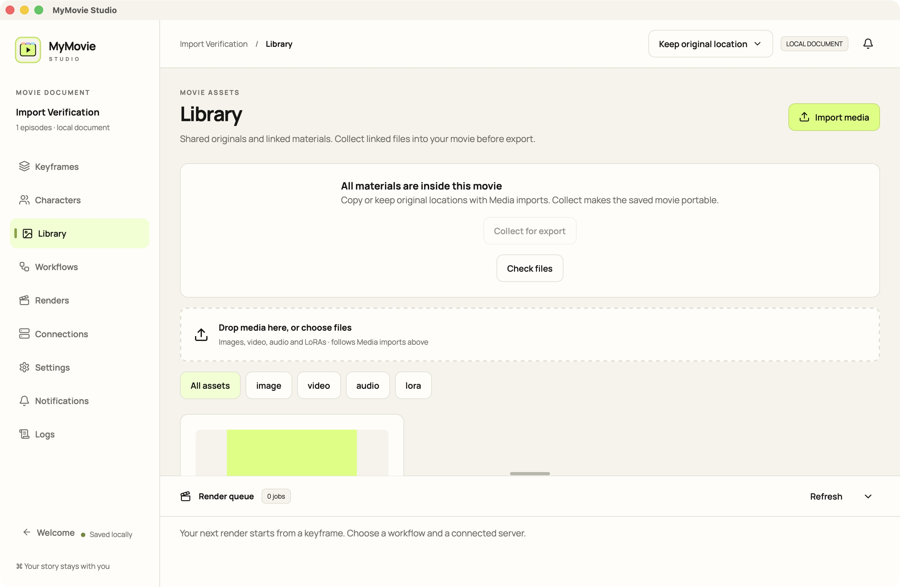

# MyMovie Studio

A local-first macOS film studio built with Rust, Tauri and React. Movies are Finder `.mymovie` document packages containing episodes, an ordered storyboard, characters, imported workflows, generation records and media. The desktop uses Fenki’s palette and an original SVG symbol.

[Русский](README.ru.md) · [Français](README.fr.md) · [Implementation status](docs/PROJECT_CONTEXT.md)



## Working with a movie

Create a movie and choose its location, or open an existing `.mymovie` package. Rename the movie and episodes, add scenes and shots, then arrange keyframes. Edit prompts, comments, aspect ratios and participating characters. Scene characters are inherited by their frames.

Import character reference images through the character editor. File-drop routing is implemented for characters, the Library, existing frames, shot lanes and new scenes. Actual Finder drag-and-drop acceptance is still unverified; use the import buttons if a drop does not arrive.

## Copy or link materials

The **Media imports** control offers two modes:

- **Copy into movie** (default): originals are copied into the package and deduplicated by content.
- **Keep original location**: the movie references the existing file without copying it. Keep the original available at that location.

This applies to imported images, videos, audio and supported LoRA files, including character references. Workflow definitions are imported separately into the movie.

The Library lists linked locations. **Check files** detects missing or changed originals. **Relink** accepts a replacement with the exact original content, preserving frame and character assignments.

Before transferring a linked movie, choose **Collect for export**. It verifies and copies all linked materials into the current `.mymovie`, keeping their assignments. Missing or changed originals stop collection. Close the movie, then copy the complete package in Finder. This is collection into the current movie; a separate archive/export-copy wizard is not implemented.

Native picker import and linked character reference collection were verified in the macOS app.

## Workflows and connections

Import an API-format workflow and explicitly bind its prompt, image and other inputs. `characterReference1` through `characterReference4` can use reference images from the scene/frame cast. The app does not guess arbitrary node mappings.

Connections support multiple ComfyUI, RunningHub and private-relay records. Google, DeepSeek and OpenRouter prompt assistance is optional. Enter secrets through secure app controls; credentials are stored in the macOS Keychain. fal/custom generation endpoints currently have configuration UI only.

Job receipts and results persist. Ambiguous submissions become unknown rather than being retried blindly. The relay exposes replayable SSE; the desktop currently polls. Native Dock progress and system notifications accompany in-app notification/log histories.

## Development

Requirements: Apple Silicon macOS 13 or newer, Xcode Command Line Tools, Rust and Node.js/npm.

```sh
npm ci
npm run tauri:dev
```

Build an unsigned development application:

```sh
npm run tauri:build -- --debug --bundles app
```

Output: `target/debug/bundle/macos/MyMovie Studio.app`. Browser preview (`npm run dev`) uses temporary in-memory state; use the native app for file/package acceptance.

```sh
npm run typecheck
npm test -- --maxWorkers=1
cargo test --workspace
```

## Local CPU execution

```sh
docker compose -f deploy/cpu/compose.yaml up -d --build
python3 scripts/cpu-smoke.py
```

Keep the OrbStack/Docker engine running; the OrbStack window may be closed. The weight-free CPU canary verified ComfyUI health, submission, history and result download. It does not validate the supplied GPU video workflows.

## Current limits

This is a development foundation. Live RunningHub generation, private relay/S3/RunPod roundtrip, GPU workflows, release signing/notarization, DMG packaging and complete Finder-drop acceptance remain pending. Browser profiles, remote LoRA training and the complete FFmpeg derivative pipeline are later milestones. No paid generation or cloud rental was performed during validation.

See [architecture](docs/ARCHITECTURE_INDEX.md), [contracts](docs/API_CONTRACTS.md) and [test evidence](docs/TASK_LOG.md). Agents should read the six compact context documents before targeted source inspection. Keep `drafts/`, secrets and personal movie packages out of Git.

## License

Apache-2.0 OR MIT; see [Apache license](LICENSE-APACHE) and [MIT license](LICENSE-MIT).

Bundled font licenses: [Manrope](docs/licenses/Manrope-OFL.txt), [IBM Plex Mono](docs/licenses/IBM-Plex-Mono-OFL.txt).
